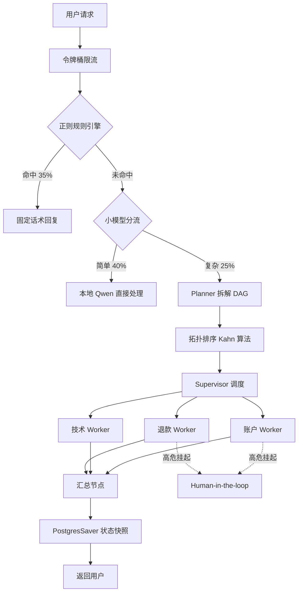

# 智能工单助手 Agent 系统

> 基于 LangGraph 的多 Agent 协作工单处理系统，支持退款、技术支持、账户操作三大业务场景，涵盖 Planner 任务拆解、RAG 五层检索、Human-in-the-loop 高危操作审批、三层 Prompt 注入防护、QLoRA 微调等完整工程链路。

<p align="left">
  
  
  
  
  
  
</p>

---

## 🏗️ 架构总览



---

## 🎯 核心技术亮点

| 模块 | 方案 | 价值 |
|---|---|---|
| **多 Agent 编排** | Planner 拆解 DAG + Kahn 拓扑排序 + Supervisor 调度 | 支持多意图、有依赖关系的复杂工单 |
| **RAG 五层架构** | 切片 + 并行召回 + RRF + Reranker 精排 + Small-to-Big + HyDE | 检索准确率显著提升 |
| **命名空间隔离** | AgentState 单向数据流，每个 Worker 只写自己的字段 | 杜绝并发写冲突 |
| **崩溃恢复** | PostgreSQL + PostgresSaver 状态持久化 | 任意步骤可回滚、可重放 |
| **Human-in-the-loop** | 高危操作（退款、重置密码）挂起，客服审批 API 唤醒 | 资金/账户操作零风险 |
| **三层 Prompt 注入防护** | InputGuard 正则黑名单 + 安全系统提示 + OutputGuard | 阻断越狱、指令覆盖、命令注入 |
| **三层降本架构** | 正则规则 → 小模型分流 → 大模型按需调用 | API 调用成本下降约 40% |
| **四维评估体系** | Pydantic 格式校验 + GPT-4 质量打分 + 推理耗时 + Token 成本 | 可量化、可回归 |
| **QLoRA 微调** | Qwen-1.8B + 困难负样本 + 严格控 Epoch | 本地小模型服务意图分类 |

---

## 🔍 RAG 五层架构详解

```
用户 Query
   ↓
【第 1 层】查询理解：HyDE 生成假想答案，缩小口语化与文档的语义鸿沟
   ↓
【第 2 层】多路并行召回：BM25（关键词） + 向量（语义），ThreadPoolExecutor 并行
   ↓
【第 3 层】RRF 融合：Reciprocal Rank Fusion 平滑两路排名差异
   ↓
【第 4 层】Rerank 精排：BGE-Reranker Cross-Encoder 深度语义打分
   ↓
【第 5 层】Small-to-Big：子块负责精准检索，父块负责喂给 LLM
   ↓
Redis 缓存（1 小时 TTL）→ 返回结果
```

---

## 🛡️ 三层安全防护

| 层级 | 位置 | 拦截内容 |
|---|---|---|
| **第 1 层** | 用户 Query 输入 | 指令覆盖、角色扮演越狱、系统命令、SQL 注入、数据窃取（10+ 条正则） |
| **第 2 层** | LLM 系统提示词 | 业务边界约束 + 禁止角色扮演 + 禁止泄露系统提示 + 用户输入视为数据 |
| **第 3 层** | LLM 输出 | 系统提示泄露、API Key/Token、敏感路径、数据库连接串 |

---

## 📦 快速开始

### 前置条件

- Python 3.10+
- Docker Desktop（含 WSL 2）
- 兼容 OpenAI 协议的大模型 API（推荐 [DeepSeek](https://platform.deepseek.com/)）

### 启动步骤

```bash
# 1. 启动中间件（PostgreSQL + Redis）
docker-compose up -d

# 2. 安装依赖
pip install -r requirements.txt

# 3. 配置环境变量
cp .env.example .env
# 编辑 .env，填入 OPENAI_API_KEY 等

# 4. 初始化数据库
python -m app.domain.init_db

# 5. 初始化知识库（切片 + 向量化 + 入库）
python -m scripts.init_knowledge

# 6. 启动 API 服务
uvicorn app.api.main:app --reload --port 8000
```

打开 http://127.0.0.1:8000/docs 查看 Swagger 接口文档。

---

## 🧪 四维评估

系统内置四维评估体系，可对 Agent 输出做量化回归测试：

```bash
python -m scripts.run_eval
```

| 维度 | 指标 | 说明 |
|---|---|---|
| **格式** | Pydantic 强校验通过率 | 验证 Agent 输出是否符合契约 |
| **质量** | GPT-4 打分（1-10） | 相关性、完整性、专业性 |
| **性能** | 平均推理耗时（秒） | 端到端延迟 |
| **成本** | 总 Token 数 | API 调用成本 |

评估数据集：`evals/datasets/golden.json`（覆盖退款、技术、账户、闲聊、异常五类场景）。

---

## 🎓 QLoRA 微调工程

`finetune/` 目录是独立的微调子工程：

```
finetune/
├── data/
│   └── seeds.jsonl               # 手写种子数据
├── configs/
│   └── qlora_qwen1.8b.yaml       # LLaMA-Factory 配置
└── scripts/
    ├── s01_generate_data.py      # 种子扩展（30 → 500）
    ├── s02_dedup.py              # N-gram + 语义去重
    ├── s03_split.py              # 8:1:1 划分
    ├── s04_train_qlora.py        # QLoRA 微调（困难负样本）
    └── s05_eval_finetuned.py     # 四维评估对比
```

**工程亮点**：
- **困难负样本**：混入"语义相近但标签不同"的样本，防止模型只学表面词汇
- **严格控 Epoch**：小样本 2 轮训练，避免灾难性遗忘
- **双层去重**：N-gram 精确去重 + BGE 语义去重，剔除约 15% 冗余

---

## 📁 目录结构

```
agent-ticket-system/
├── app/
│   ├── api/                    # FastAPI 接口层（限流 + 正则 + 安全 + 路由）
│   ├── core/                   # 配置、数据库、LLM 工厂、Redis、安全模块
│   ├── domain/                 # 领域模型（ORM）
│   ├── agent/                  # Agent 层
│   │   ├── planner/            # Planner 拆解 + 拓扑排序
│   │   ├── supervisor/         # Supervisor 调度器
│   │   ├── workers/            # 三个 Worker（退款/技术/账户）
│   │   ├── graph/              # LangGraph 主图 + 状态定义
│   │   └── tools/              # 工具注册中心
│   ├── rag/                    # RAG 引擎 + 切片器
│   └── eval/                   # 四维评估器
├── evals/
│   └── datasets/
│       └── golden.json         # 黄金测试集
├── finetune/                   # QLoRA 微调子工程
├── scripts/                    # 初始化脚本
├── tests/
├── docker-compose.yml
├── requirements.txt
└── README.md
```

---

## 🛠️ 技术栈

| 类别 | 技术 |
|---|---|
| **Agent 编排** | LangGraph、LangChain |
| **大模型** | DeepSeek / OpenAI 兼容 API |
| **小模型** | Qwen-1.8B + LoRA（本地） |
| **Embedding** | BGE-M3（1024 维） |
| **Reranker** | BGE-Reranker-Large |
| **向量库** | PostgreSQL + pgvector |
| **缓存/限流** | Redis |
| **状态持久化** | PostgresSaver |
| **Web 框架** | FastAPI + Uvicorn |
| **微调框架** | LLaMA-Factory + PEFT |
| **容器化** | Docker + Docker Compose |

---

## 📄 License

MIT © 2026 bobo

---

## 📮 联系方式

- GitHub: [@booolxy](https://github.com/booolxy)
- Email: cb1208cb@qq.com